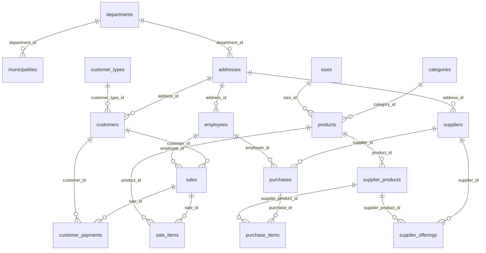

# Modelo de datos: referencia, esquema inicial y limites

Actualizacion posterior al corte: 30 modelos, head 0005_cash_checkout. Se agregan
seis tablas de [caja](cash-register.md) y movimientos sale_return; no se infieren
pagos historicos ni se modifican revisiones previas. Los hitos siguientes describen
la evolucion del esquema y no sustituyen el contrato actual de caja.

Desde fase 5 existe un esquema PostgreSQL inicial de compatibilidad: 17 modelos
SQLAlchemy y revision Alembic `0001_compatibility`. La base local de desarrollo
creada en fase 4 tiene ese esquema, sin registros de negocio. Esto no significa
que se haya inspeccionado o trasladado la base SQL Server.

## Fuente de verdad disponible

Actualizacion de fase 10: 24 modelos/tablas, head 0004_atomic_sales. SaleWorkflow
agrega auditoria e idempotencia sin poblar historicos; inventory_movements admite
una linea de compra o de venta con delta correspondiente. B03 de ventas y B04
confirmados: precio de producto copiado por linea, total de servidor y ventas
inmutables. Se preservan las tablas legacy y los movimientos de compras existentes.
Tipos, reglas y limites en [ventas](sales.md). Verificado solo en pruebas aisladas.

Actualizacion de fase 9: 23 modelos/tablas, head 0003_purchase_receipts. Se agregan
purchase_workflows, purchase_item_costs e inventory_movements sin alterar las
tablas legacy ni reconstruir costes/movimientos. B01 define stock disponible,
cantidadstock legado; B02/B05 y costes de compra B03 confirmados. Reglas y
tipos nuevos en [compras e inventario](purchases-inventory.md). Los datos
anteriores conservan nulos y valores originales; stock cero es solo para altas
de productos de la nueva API, no un default/mapeo retroactivo de base.

Actualizacion de fase 8: el registro ORM contiene ahora 20 modelos/tablas,
17 comerciales y 3 propios de identidad. La nueva revision 0002_identity agrega
user_accounts (employee_id opcional y unico), web_sessions y login_throttles.
B09 y los roles estan aprobados; [autenticacion](authentication.md) describe
campos, permisos y limites. No son tablas del origen legacy ni forman parte de
la matriz ETL. La revision nueva se aplico solo en pruebas aisladas.

El codigo declara 17 modelos de negocio en los seis archivos models.py activos.
Todos usan managed=False; por tanto, sus migraciones no administran las tablas.
Los nombres, campos, tipos declarados y ejemplos se encuentran en
[legacy-api-contracts.md](legacy-api-contracts.md), sin duplicar ese diccionario aqui.

La base fisica SQL Server no se ha inspeccionado. No tomar los modelos como
inventario completo de tablas, PK, FK, restricciones, indices, triggers o usuarios.
El archivo autogenerado `backend/hdboutique/modelos_bd.py` no es el modelo activo
ni una fuente de esquema actualizada.

## Relaciones declaradas en codigo

Cada flecha representa una FK desde la entidad de la izquierda hacia la derecha.
No afirma haber verificado su existencia fisica.

| Entidad | Entidades referenciadas |
| --- | --- |
| Municipio | Departamento |
| Direccion | Departamento; no tiene FK a Municipio |
| Clientes | Direccion, TipoCliente |
| Empleados | Direccion |
| Productos | Categoria, Tallas |
| Proveedores | Direccion |
| Productoproveedor | Productos |
| Ofrece | Proveedores, Productoproveedor |
| Compras | Proveedores, Empleados |
| Detallecompra | Compras, Productoproveedor |
| Venta | Clientes, Empleados |
| Detalleventa | Venta, Productos |
| DeudaCliente | Clientes, Venta |

Departamento, TipoCliente, Categoria y Tallas no declaran otras FK. Los 16 modelos
distintos de Ofrece declaran una PK AutoField explicita. Ofrece no declara PK y
Django espera una identidad implicita; falta verificar como se identifica la fila
real. Todas las FK del codigo usan DO_NOTHING: eso describe al ORM, no certifica
que la base carezca de restricciones o de proteccion contra borrados.

## Puntos de integridad que condicionan el nuevo esquema

| Asunto | Tratamiento antes de definir PostgreSQL |
| --- | --- |
| Dos existencias anulables | Resolver B01 y perfilar valores; no eliminar una columna por similitud de nombre |
| Precio producto decimal, detalle venta entero | Corregir D03 sin inventar centavos historicos |
| Coste en ProductoProveedor y no en DetalleCompra | Confirmar de donde recuperar costes historicos; no usar automaticamente precio actual |
| Cabeceras y lineas independientes | Definir casos de uso atomicos y politica de operaciones confirmadas |
| DeudaCliente contiene abonos | Confirmar B06; no inferir principal, saldo o sobrepagos |
| Direccion sin municipio | Resolver B08 antes de agregar relaciones o rellenar historicos |
| Campos texto opcionales y sin unicidad declarada | Buscar nulos/duplicados antes de endurecer restricciones |
| Fecha sin hora | Preservar DATE; no reconstruir instantes inexistentes |
| Collation SQL Server | Revisar comparacion por mayusculas, acentos y unicidad en el destino |

## Esquema PostgreSQL inicial implementado

En fase 5 el usuario confirmo conservar ambos campos de existencias separados y
Direccion ligada solo a Departamento. Esa decision habilita esta base estructural;
no resuelve el significado de B01 ni el contrato futuro B08. Las demas decisiones
de [negocio](business-rules.md) siguen pendientes.

| Modelo legacy declarado | Tabla destino | PK destino | Modulo SQLAlchemy |
| --- | --- | --- | --- |
| Departamento | departments | department_id | locations |
| Municipio | municipalities | municipality_id | locations |
| Direccion | addresses | address_id | locations |
| TipoCliente | customer_types | customer_type_id | customers |
| Clientes | customers | customer_id | customers |
| DeudaCliente | customer_payments | payment_id | customers |
| Empleados | employees | employee_id | staff |
| Categoria | categories | category_id | catalog |
| Tallas | sizes | size_id | catalog |
| Productos | products | product_id | catalog |
| Proveedores | suppliers | supplier_id | suppliers |
| Productoproveedor | supplier_products | supplier_product_id | suppliers |
| Ofrece | supplier_offerings | offering_id | suppliers |
| Compras | purchases | purchase_id | purchases |
| Detallecompra | purchase_items | purchase_item_id | purchases |
| Venta | sales | sale_id | sales |
| Detalleventa | sale_items | sale_item_id | sales |

Los modelos estan en `backend/app/modules/<module>/models.py`; el registro explicito
es backend/app/infrastructure/database/models.py. El mapeo de campos vive en
[compatibilidad](contract-compatibility.md#campos). No hay endpoints de negocio
nuevos ni cambios de payload Django.

El diagrama muestra relaciones estructurales del destino, no reglas de stock,
recepcion, cobro o correccion de operaciones.

## Tipos, restricciones e indices

| Asunto | Decision implementada y limite |
| --- | --- |
| Identidades | 17 PK INTEGER GENERATED BY DEFAULT AS IDENTITY: generan IDs y permiten insertar IDs preservados. No adelantan la secuencia al importar IDs explicitos; fase 6 debe realinearlas |
| Ofrece | offering_id identifica filas del destino sin imponer unicidad de proveedor/producto. No afirma que el origen tenga esa PK; verificar y mapear en fase 6 |
| Relaciones | 21 FK no anulables con ON DELETE RESTRICT; protegen referencias e historicos sin borrados en cascada. No implementan anulaciones comerciales |
| Indices | 21 indices B-tree de FK; las PK tienen su indice propio. Sin indices de busqueda o reportes especulativos antes de sus consultas |
| Nombres | `pk_<table>`, `fk_<table>_<column>`, `ix_<table>_<columns>`; convencion compartida por metadata y Alembic |
| Dinero | Numeric(10,2)/Decimal en campos monetarios declarados como DecimalField legacy; no float ni valores monetarios por defecto |
| Precio de linea de venta | Numeric(12,2): admite centavos y todo el rango INTEGER firmado de origen. Numeric(10,2) no preservaria sus diez digitos enteros. No define descuentos o redondeo B03 |
| Fechas | DATE, conservando nulabilidad original. refill_date no se interpreta como recepcion; no se inventan horas ni orden temporal B05 |
| Textos y telefonos | Longitudes y nulabilidad declaradas por Django, incluidos telefonos de hasta 10 caracteres. No se fuerza ocho digitos ni se sustituyen nulos por vacios |
| Existencias | cantidadstock -> legacy_stock_quantity; stock -> legacy_stock. INTEGER anulables independientes, sin defaults, suma automatica, umbral ni significado nuevo |
| Direcciones | department_id requerido y address_line anulable; municipalities conserva su propio departamento. Sin municipality_id en addresses |
| Unicidad | Solo PK: no deduplicar nombres, contactos, ofertas o lineas por una unicidad no verificada |

El destino mantiene los dominios estructurales declarados: no agrega todavia CHECK
de positividad, stock, fechas o importes, ni igualdad cliente/venta de un abono.
Esto permite representar datos legacy sin inventar su validez comercial. Antes
de habilitar escrituras funcionales se deben acordar las reglas, perfilar los
historicos y agregar validaciones y restricciones mediante nuevas revisiones.
Las FK nuevas tambien pueden revelar huerfanos del origen: registrarlos y resolver
su tratamiento, sin descartarlos para hacer pasar la carga.

PostgreSQL usa UTF8 y su collation local; no se afirma equivalencia con
SQL_Latin1_General_CP1_CI_AS. No se implanta unicidad textual dependiente de esa
comparacion sin el perfilado de fase 6.

## Evolucion pendiente

SQLAlchemy 2.x describe el modelo nuevo y Alembic su evolucion versionada.
No usar create_all como mecanismo de despliegue que compita con las migraciones.
La fase 5 implementa y comprueba esta base de compatibilidad; la fase 6 ensaya el traslado
de datos desde un origen autorizado.

El mapeo inicial de tablas/columnas esta en
[contract-compatibility.md](contract-compatibility.md). Mantener IDs y mapeos cuando
se cambien nombres. Las entidades nuevas de inventario/identidad se definiran con
sus reglas y no se presentaran como tablas existentes del origen.

Los importes nuevos usan NUMERIC y Decimal. Restricciones de cantidades,
unicidad, indices y borrado se revisaran contra reglas aprobadas y datos reales.
Salvo B09 confirmado en fase 8, las reglas definitivas B01-B14 siguen pendientes:
una propuesta arquitectonica no aprueba
su politica comercial. Para conservacion y conciliacion, ver
[migration.md](migration.md).

En fase 5 no se agregaron saldo/principal, estados, usuarios/roles, movimientos, colores,
SKU, costes historicos inferidos ni nuevas funciones de caja. D10 sigue pendiente:
supplier_products.purchase_price no sustituye un coste historico de compra.
Los nuevos casos de uso y sus restricciones ampliaran este esquema por Alembic,
sin reescribir la revision inicial ya aplicada. Ver
[ADR 0004](decisions/0004-compatible-schema-foundation.md).
